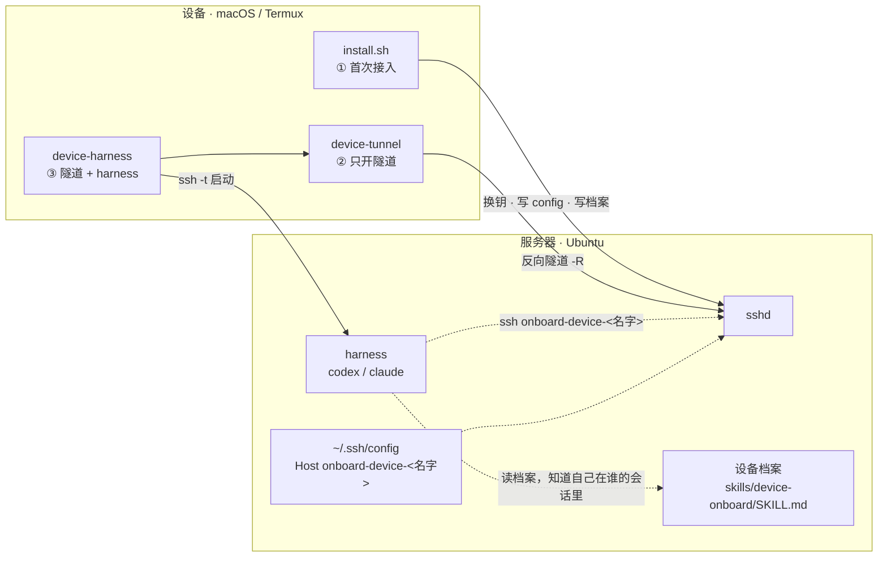

<div align="center">

# device-onboard

**把任意一台设备，接入你那台常开的 AI 服务器。**

设备只当终端入口 —— harness、skills、项目环境全部集中在服务器上。


</div>

> 在手机上敲一句 `device-harness`，服务器上就起来一个 codex 会话。它知道自己在跟哪台设备说话，也能直接读写那台设备里的文件。

---

## 为什么做这个

手工接一台设备要走的流程：生成密钥 → 两边换公钥 → 挑一个不冲突的端口 → 建 SSH 别名 → 记笔记。接过两台之后就会发现它**慢、易错、没记录** —— 真实事故是手工抄公钥漏了一个字符，排查了 20 轮。

这个仓库把那套流程收敛成一条命令，并把「这台设备是谁」变成服务器上一个**可读的档案**，而不是某个人脑子里的记忆。

## 它是怎么工作的

三个角色：**设备**（你手边这台，Mac 或 Android 手机）、**服务器**（常开、算力大）、**harness**（服务器上真正干活的东西，默认 codex）。

设备是**主动方**：所有连接都由设备发起，服务器不需要能直接访问设备。这靠一条由设备建立的反向隧道实现。



接入成功后，两边的 `~/.ssh/config` 里各多出一个 Host：

| 别名 | 在哪用 | 干什么 |
|---|---|---|
| `server` | 设备 | 进服务器 / 在服务器上跑命令 |
| `onboard-device-<名字>` | 服务器 | 通过反向隧道连回设备 |

设备侧就 `server` 一个 —— 每台设备只对一台服务器，再加设备名后缀纯属噪音。**反向隧道不单独占一个 Host**：端口只在状态文件里存一份，`device-tunnel` 拼 `-R` 时现场取，免得日后与 `~/.ssh/config` 里的副本分叉。

## 快速开始

### 前置条件

- 设备：macOS，或装了 Termux 的 Android。只需要系统自带的 `ssh` / `ssh-keygen`。
- 服务器：一台常开、能 SSH 登录的机器（局域网、公网、VPN 都行）。
- macOS 需要打开 **系统设置 → 通用 → 共享 → 远程登录**（脚本会检查并提示）。

### 首次接入

在**设备**上：

```sh
git clone https://github.com/MuRain37/device-onboard.git
cd device-onboard
sh install.sh
```

脚本会安装 `device-tunnel` / `device-harness` 两个本地命令，然后直接进入接入设置，依次问你设备名、服务器地址、用户名、SSH 端口。

密码只由 `ssh` 自己提示**输一次**，脚本不读取、不保存、不落盘 —— 这一步是唯一的人工交互，**刻意不做全自动**。之后全程免密。

### 日常使用

```sh
device-harness                      # 一键：起隧道 + 在服务器上跑 codex
device-harness claude               # 换别的 harness
device-harness -C '~/项目' claude   # 指定服务器上的工作目录
device-harness dsh                  # 起服务器上的 dsh web，在设备浏览器里用
device-tunnel                       # 只起反向隧道，前台保持，Ctrl-C 结束
ssh server                          # 进服务器普通 shell
```

### 更新工具

```sh
git pull && sh install.sh
```

检测到已有接入就**只更新本地命令**，跳过接入向导、**一个字节都不碰 `~/.ssh/config`** —— 配置块是「产物」，状态文件才是「源」，清掉却重建不出来就把已经接好的设备弄瘸了。

两种情况需要额外一条命令：

```sh
sh install.sh --repair   # 不动密钥、不重新接入：重写双方的 config 标记块，并把服务器侧的
                         # 设备档案/提示块按当前版本重铺（别名规则变了、新增支持的 harness、
                         # 落点改了 —— 都用它迁移）
device-uninstall && sh install.sh   # 想彻底重接（换服务器、换设备名）
```

### 卸载

```sh
device-uninstall               # 全拆：命令、双方的 config 区块、双方的授权行、密钥、状态文件
device-uninstall --keep-keys   # 只拆派生产物，留密钥与双方的授权行（想留凭据重接时用）
```

拆完等于「这台设备从没接过」——**install.sh 装了什么就删什么**，包括服务器上的设备档案和记忆文件里的「设备会话」提示块（那些块不分设备，服务器上还有别的设备时脚本会警告，但不会替你做主保留）。服务器那一半需要能连上服务器才拆得掉；连不上会明确告诉你「服务器侧没拆干净」，本地照拆。

### 用 dsh（DeepSeek Harness）：在设备浏览器里打开服务器的 Web GUI

```sh
device-harness dsh
```

```
✅ dsh web 已就绪。在设备浏览器里打开：

    http://127.0.0.1:9230/?token=…

   这条 URL 带着一次性凭据，别外发。Ctrl-C 结束（dsh web 与隧道一起收）。
```

背后发生的事：`dsh web` 只监听服务器的 loopback，所以脚本**挑一个服务器上空闲的端口**起它，再用 `ssh -L` 把设备 `127.0.0.1:<同一个号>` 转发过去 —— 于是那条 URL 在设备上原样点开就行，不用改 host、不用开防火墙、也不至于把 Web GUI 暴露在公网。设备上那个端口要是被占了（比如你本机也开着 dsh），脚本会顺位换号并把 URL 里的端口改好再给你。

反向隧道照旧一起起：dsh 里那个 agent 仍然可以 `ssh onboard-device-<名字>` 回到设备上干活。

**设备视图（`--device-view`）：不再靠提示词让 agent 自己 `ssh`。**
会话在服务器上开一个 **mount namespace**：设备家目录按**相同绝对路径**挂进来（`/Users/mac` → 服务器 `/Users/mac`），`/usr/bin/{bash,zsh}` 换成**转发到设备**的垫片，harness 在里面跑。于是 agent 看到的路径、读写的文件、跑的命令，全都落在设备上 —— 它不需要知道"这是远程"，也就不需要被告知（原来那套 skill + AGENTS.md 提示已经删掉）。

会话结束，命名空间消失，挂载和 shell 替换一起没 —— 没有"忘了卸载"这回事，`kill -9` 也不会留僵死挂载。

```sh
device-harness --device-view          # 开（auto：服务器装好了就用）
device-harness --no-device-view       # 关，回到普通远程会话
DEVICE_ONBOARD_DEVICE_VIEW=0          # 等价的环境变量
```

代价与边界：文件操作走 FUSE（手机偏慢、没有 `inotify`）、命令延迟约 60ms/条（连接复用后）、服务器算力不参与；命令失败会明确报错，**绝不静默回落到本地执行**。

## 命令速查

| 想做什么 | 在哪跑 | 命令 |
|---|---|---|
| 首次接入 | 设备 | `sh install.sh` |
| 更新工具 | 设备 | `git pull && sh install.sh`（只更新本地命令） |
| 重写 config 块 + 重铺服务器产物 | 设备 | `sh install.sh --repair` |
| 彻底卸载 | 设备 | `device-uninstall` |
| 只拆不装 | 设备 | `device-uninstall --keep-keys` |
| 一键干活 | 设备 | `device-harness [-C <服务器目录>] [harness] [参数…]` |
| 在设备浏览器里用 dsh | 设备 | `device-harness dsh`（自动转发 dsh web 的端口） |
| 只开反向隧道 | 设备 | `device-tunnel` |
| 进服务器 | 设备 | `ssh server` |
| 从服务器操作设备 | 服务器 | `ssh onboard-device-<名字> '<命令>'` |
| 跑测试 | 任意 | `sh tests/smoke.sh` |

## 设计要点

这几条看着啰嗦，但每一条都是真机踩出来的。

**① 就绪信号由服务器打印，不是本地瞎报。**
`device-tunnel` 起隧道时带 `-o ExitOnForwardFailure=yes`，所以只有服务器**真把端口绑上**了，才可能执行到打印「✅ 反向隧道已建立」那行。本地「我发出去了」毫无意义 —— 这是唯一能区分「隧道通了」和「端口被占」的证据。`device-harness` 等的就是这个信号，而不是轮询端口。

**② 首次接入做端到端握手，不看进程也不看端口。**
进程活着但转发已断的情况真实存在。接入时会启动一条临时隧道，让服务器**真连回设备一次**，必须回显 `DEVICE-ONBOARD-E2E-OK` 才算通过。绑上但握手失败会立刻中止 —— 并明确告诉你「换端口没用」。

**③ 设备身份只走环境变量。**
`DEVICE_ONBOARD_ID` / `DEVICE_ONBOARD_DEVICE_ALIAS` 由 `device-harness` 在 `ssh -t` 时传进服务器会话。**没有 `~/<设备名>` 这类锚点目录** —— 目录可以随处 `cd`，身份不行。设备里的文件也不再同步，直接 `ssh onboard-device-<名字>` / `scp` 读写。

**④ codex 要带 `--no-daemon`。**
交互式 Codex 把「执行工具命令」交给常驻的 `app-server` 守护进程，而那个进程继承的是**它启动那一刻**的环境，于是本次会话才有的 `DEVICE_ONBOARD_ID` 传不到工具手上（实测：工具 shell 里的 `SSH_CLIENT` 与两天前那个守护进程逐字一致）。`--no-daemon` 让工具在本次会话进程里执行，环境变量才有效。

**⑤ 隧道和 harness 同生共死。**
分两条命令不行就在于生命期：隧道是后台长跑，harness 是前台交互，中间断了谁都发现不了。`device-harness` 把它们绑在一起，退出时一定收干净。

**⑥ 只改自己带标记的区块。**
所有对 `~/.ssh/config`、`~/.codex/AGENTS.md`、`~/.claude/CLAUDE.md` 的写入都限制在 `BEGIN` / `END` 标记之间，改前备份，标记外的手写内容一律不动。首次接入半路失败会按标记撤销、还原备份。

**⑦ dsh 是网页，不是终端 —— 走本地转发，且就绪信号仍然是「服务器说的」。**
`dsh web` 只绑 loopback（连 `--host 0.0.0.0` 都不支持），所以「在设备上打开」天然就是 `ssh -L` 的活：两边用同一个端口号，它打印的那条 URL 才能在设备上原样点开（它还会校验 Host 必须是 loopback —— 转发之后仍是 `127.0.0.1`，正好满足）。就绪判据也没换样：等 `dsh web` 自己那行 `dsh web: <URL>`，不等端口；没打出这行就是没起来，把它的输出摊给你看。

**⑧ 卸载和更新是两件事，别混。**
更新只换本地命令，刻意不碰 `~/.ssh/config`；真要重写配置块有 `--repair`；真要拆干净有 `device-uninstall`。这三件事各自只有一个入口，谁也不偷偷替谁做事。卸载的语义是「装了什么就删什么」，所以它连服务器上的设备档案、记忆文件里的「设备会话」提示块一起删 —— 注意那些提示块**不分设备**，一台服务器上还登记着别的设备时，删掉它们会让那台的会话少这条说明，脚本会明确警告，但不会替你做主保留。

## 装了 / 写了哪些东西

**设备侧**

| 路径 | 内容 |
|---|---|
| `~/.config/device-onboard/config` | 本机接入配置（别名、端口、设备 ID） |
| `~/.ssh/device-onboard/` | 设备私钥（**私钥永不出设备**） |
| `~/.ssh/config` | 新增 `Host server` 标记块（进服务器的入口） |
| `$DEVICE_ONBOARD_BIN_DIR` | 安装的 `device-tunnel` / `device-harness` / `device-uninstall` |

**服务器侧**

| 路径 | 内容 |
|---|---|
| `/opt/device-onboard/device-view` | 会话级启动器：建命名空间 → 同路径挂载 → 起 harness |
| `/opt/device-onboard/shim/{sh,bash,zsh}` | 转发垫片：把命令送到设备上执行 |
| `/opt/device-onboard/real-sh` | 私有 POSIX 壳副本（垫片的 shebang 只能指向它，否则自我递归） |
| `/Users/<设备用户>`（同路径） | 挂载点：设备家目录挂到这里 |
| `~/.ssh/config` | `onboard-device-*` 回连 Host 块 |

档案只记重新生成 SSH 配置所需的最小信息（设备名、端口、钥匙名、用户），**不存私钥**，也**不存易变字段**（比如「最后在线时间」—— 那是运行时事实，用时现场查）。

## 环境变量

`install.sh` 支持这些覆盖项（`sh install.sh --help` 也能看到）：

| 变量 | 默认 | 作用 |
|---|---|---|
| `DEVICE_ONBOARD_BIN_DIR` | macOS `/usr/local/bin`，Termux `$PREFIX/bin` | 本地命令安装目录 |
| `DEVICE_ONBOARD_CONFIG_DIR` | `~/.config/device-onboard` | 配置目录 |
| `DEVICE_ONBOARD_KEY_DIR` | `~/.ssh/device-onboard` | 密钥目录 |
| `DEVICE_ONBOARD_DEVICE_SSH_PORT` | macOS `22`，Termux `8022` | 本机 sshd 端口 |
| `DEVICE_ONBOARD_REVERSE_PORT_START` / `_END` | `2230` / `2299` | 反向端口范围（避开手工占用的低位端口） |
| `DEVICE_ONBOARD_AGENTS_MD` | `1` | 设为 `0` 跳过服务器 `~/.codex/AGENTS.md` 的标记块 |
| `DEVICE_ONBOARD_CLAUDE_MD` | `1` | 设为 `0` 跳过服务器 `~/.claude/CLAUDE.md` 的标记块 |
| `DEVICE_ONBOARD_DEVICE_VIEW` | `auto` | `1` 强制设备视图（缺依赖就报错）、`0` 关掉、`auto` 装好了就用 |

`device-harness dsh` 另有两个（在设备上跑命令时用）：

| 变量 | 默认 | 作用 |
|---|---|---|
| `DEVICE_ONBOARD_DSH_WEB_PORT` / `_END` | `9230` / `9299` | 给 `dsh web` 挑端口的范围（设备侧被占时顺位） |
| `DEVICE_ONBOARD_DSH_WAIT` | `180` | 等 `dsh web` 打印 URL 的秒数 |

## 测试

```sh
sh tests/smoke.sh
```

冒烟测试用一个假的 `ssh` 桩件在临时 `HOME` 里跑完整流程，不碰真实服务器、不需要网络。

## 项目结构

```
install.sh              # 首次接入 + 安装本地命令（757 行，平台差异全收在 detect_platform）
bin/device-tunnel       # 起反向隧道，前台保持
bin/device-harness      # 编排：隧道 + harness，同生共死
tests/smoke.sh          # 冒烟测试（假 ssh 桩件）
docs/flow.md            # 运行流程详解，含完整 mermaid 图
docs/mvp-spec.md        # MVP 规格
onboard-design.md       # 方案讨论稿（背景、设计决定、待打磨的问题）
design-questions.md     # 设计问题清单
CONTEXT.md              # 领域词汇表
docs/adr/               # 架构决策记录
```

## 文档

| 想了解 | 看 |
|---|---|
| 完整运行流程（装了什么、两条命令各干了什么、出错怎么退） | [docs/flow.md](docs/flow.md) |
| MVP 规格 | [docs/mvp-spec.md](docs/mvp-spec.md) |
| 为什么这么设计、还有哪些没想清楚 | [onboard-design.md](onboard-design.md) |
| 术语定义 | [CONTEXT.md](CONTEXT.md) |

## 边界

这套设计**绑定「自己有一台服务器」**，不是通用工具。明确不做：

- **不追求全自动** —— 第一次鉴权必然要人参与，也刻意不加免鉴权接口。
- **不做后台隧道服务** —— 反向隧道由 `device-tunnel` 前台运行，不后台保活、不自启。
- **不做自动恢复** —— 首次接入以外不自动恢复，中断后重跑脚本。
- **不共享服务器** —— harness、skills、项目环境都集中在服务器，设备侧不重复安装 harness。
- **不做多设备协同** —— 不含工作区隔离、任务分发、自动合并。
- **不做受限钥匙** —— 权限给足，靠「随时可吊销」兜底。

首版支持 macOS 与 Termux；Linux 桌面端的 sshd、自启方式、路径差异都不同，尚未覆盖。
