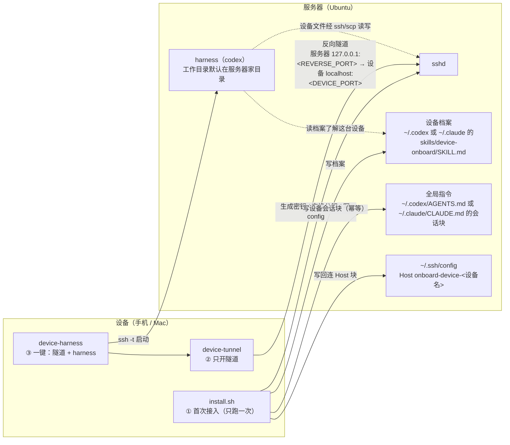
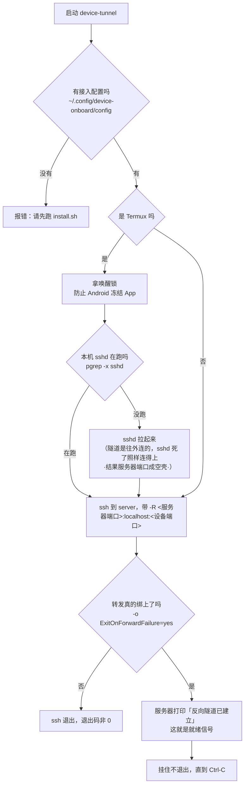
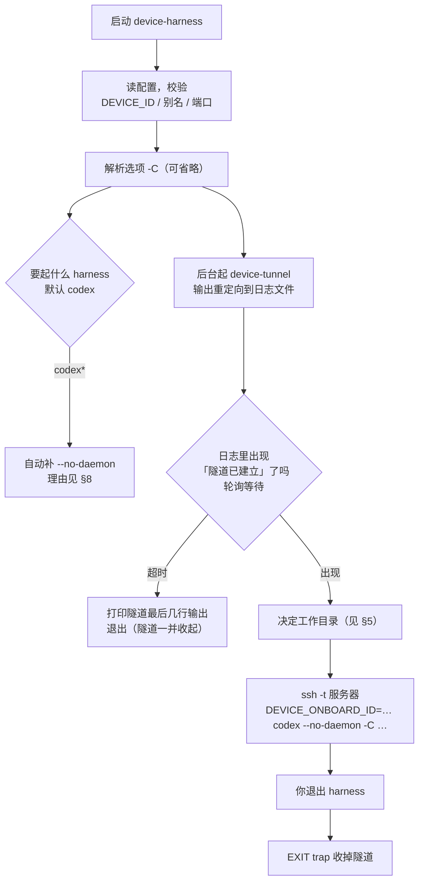
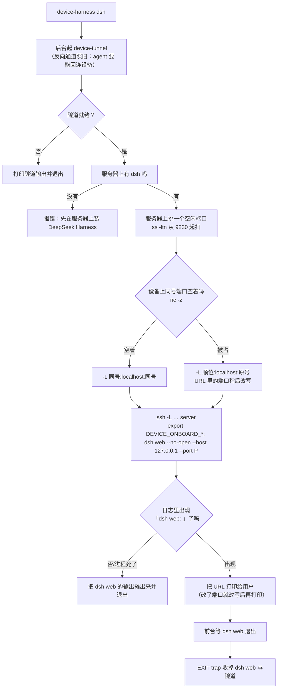

# device-onboard 运行流程

这份文档讲清三件事：**首次接入装了什么**、**日常两条命令各自干了什么**、**出错时怎么退**。
内容对应分支 `termux-port` 的实际代码（`install.sh`、`bin/device-tunnel`、`bin/device-harness`）。

---

## 0. 三个角色

| 角色 | 是什么 | 例子 |
|---|---|---|
| **设备** | 你想"从它出发干活"的那台机器 | 手机（Termux）、Mac |
| **服务器** | 常开、算力大、真正跑 harness 的那台 | 腾讯云 Ubuntu |
| **harness** | 服务器上真正干活的东西，默认 codex | codex |

方向约定：

- **正控**：设备 → 服务器（`ssh server`）
- **反控**：服务器 → 设备（靠设备先开一条反向隧道，再用 `ssh onboard-device-<设备名>`）

设备是**主动方**：所有连接都由设备发起。服务器不需要能直接访问设备。

---

## 1. 总览



---

## 2. 接入/更新：`install.sh`（在设备上跑）

**重跑只更新本地命令**：检测到状态文件就跳过接入，且**一个字节都不碰 `~/.ssh/config`**
（配置块是产物，状态文件才是源；清掉却重建不出来就把设备弄瘸了）。要重写配置块用
`sh install.sh --repair`；要彻底拆掉用 `device-uninstall`（见 §2.5）。

```mermaid
sequenceDiagram
    participant U as 你
    participant D as 设备（install.sh）
    participant S as 服务器

    D->>D: detect_platform()<br/>Darwin → macos；Termux → termux
    U->>D: 输入服务器 IP / 用户名 / 端口
    D->>S: ssh 登录（密码由你手输，脚本不存密码）
    D->>D: 生成密钥对（本地）
    D->>S: 追加公钥到服务器 authorized_keys
    S->>D: 回传服务器的公钥
    D->>D: 写进设备 authorized_keys
    D->>D: 写设备侧 ~/.ssh/config<br/>Host server
    S->>S: 写服务器侧 ~/.ssh/config<br/>Host onboard-device-&lt;设备名&gt;
    D->>S: 探测服务器装了哪些 harness（codex / claude）
    D->>S: 给每个 harness 建自己的设备档案（~/.codex 或 ~/.claude 的 skills/device-onboard/）
    D->>S: 写各自记忆文件的设备会话块（幂等）
    D->>S: 反向通道真握手验证
    Note over D,S: 让服务器在探测端口上主动连回设备一次<br/>必须回显 DEVICE-ONBOARD-E2E-OK 才算通
    D->>U: 完成，打印用法
```

### 关键点

- **密码由你手输**，脚本不保存、不落盘。
- **端到端验证**：不是"绑上端口就算通"，而是让服务器**真连回来握一次手**——
  绑上但握手失败会立刻中止，并明确告诉你"换端口没用"。
- **设备身份只走环境变量**：`DEVICE_ONBOARD_ID` / `DEVICE_ONBOARD_DEVICE_ALIAS` 由
  `device-harness` 在 `ssh -t` 时传进服务器会话，用来判断「本次会话来自哪台设备」；
  设备里的文件用 `ssh onboard-device-<设备名>` / `scp` 读写。
- **记忆文件用独立标记块维护**：`~/.codex/AGENTS.md`（AGENTS 标记）与 `~/.claude/CLAUDE.md`
  （CLAUDE 标记）；块已存在就整体替换、不存在就追加、文件不存在就创建，块以外的内容一律不动；
  回滚不管它们。`DEVICE_ONBOARD_AGENTS_MD=0` / `DEVICE_ONBOARD_CLAUDE_MD=0` 可分别跳过。
- **首次接入路径带失败回滚**：半路挂了会按标记撤销、还原备份。
- **"已有配置"重跑会走跳过路径**，那条路径**绝不改动** `~/.ssh/config`。
- **别名只有两个**：设备侧 `server`（进服务器的入口），服务器侧 `onboard-device-<设备名>`
  （给服务器上的 agent 回连设备用）。反向隧道不单独占 Host —— 端口只在状态文件里存一份，
  `device-tunnel` 拼 `-R` 时现场取；写进 `~/.ssh/config` 就等于同一个端口存两份，日后会分叉。
- **重跑只更新命令**：不重新接入、不碰 ssh config。别名规则变了、新增了支持的 harness、
  或者落点改了，都用 `--repair`（重写标记块 + 重铺服务器侧的档案/提示块，不动密钥）；
  要彻底重接就 `device-uninstall` 之后再跑一次 `install.sh`。

---

## 2.5 卸载：`device-uninstall`

```sh
device-uninstall               # 全拆：装了什么就删什么
device-uninstall --keep-keys   # 拆掉派生产物，留密钥与双方的授权行（想留凭据重接时用）
```

记忆文件里的「设备会话」块**不分设备**（只是一句「有 `DEVICE_ONBOARD_ID` 就是设备会话」的
通用说明）。卸载会把它一并删掉；如果这台服务器上还登记着别的设备，脚本会明确警告 ——
但不会替你做主保留，因为卸载的语义就是「本工具留下的东西全部消失」。

拆的东西分两半，**服务器那一半必须先拆** —— 拆完本地密钥就 ssh 不上去了：

| 位置 | 拆什么 |
|---|---|
| 设备 | 已安装的 `device-tunnel` / `device-harness` / `device-uninstall`（按状态文件里的 `BIN_DIR` 删，不去 PATH 上瞎找） |
| 设备 | `~/.ssh/config` 里本设备的标记块 + 我们留的 `.bak`；`authorized_keys` 里的回连公钥行（`--keep-keys` 时留） |
| 设备 | 设备密钥（`--keep-keys` 时留）、状态文件与配置目录 |
| 服务器 | `~/.ssh/config` 回连区块；`authorized_keys` 里本设备公钥；回连密钥（`--keep-keys` 时留） |
| 服务器 | 设备档案里本设备那一块（没有别的设备了就整个档案目录删掉）；记忆文件里的设备会话块（文件因此变空就连文件删掉） |
| 服务器 | `~/.dsh/AGENTS.md` 里本设备的登记块（文件因此变空就连文件删掉） |

两个坑写在这儿免得再踩：

- **远端脚本用引号定界的 heredoc**（`<<'EOF'`），设备 ID 与 keep 标记从命令行以 `$1`/`$2` 传进去。
  早先是「未引号 heredoc + 反斜杠转义」，漏一个 `$` 就在本地展开，`set -u` 下直接
  `unbound variable` —— 远端脚本整段没跑，卸载却报了「完成」。
- **不用 `grep -v pat file > tmp && mv tmp file` 删行**：每行都匹配时 `grep -v` 返回 1，
  后面的 `mv` 根本不执行 —— 文件原样留着，还打印「已删除」。改用 `awk 'index($0,pat)==0'`。

---

## 3. 日常之一：`device-tunnel`（在设备上跑）

只做一件事：**把服务器的某个端口，转发到设备的 sshd**。保持前台，Ctrl-C 结束。



> **为什么就绪信号必须由服务器说？** 因为只有服务器的 `sshd` 真把端口绑上了，
> 才可能执行到那行打印。本地瞎报"已建立"没有意义。

---

## 4. 日常之二：`device-harness`（一键，在设备上跑）

```
device-harness [-C <服务器上的目录>] [harness 命令] [命令参数...]
```

它是**编排层**：把隧道和 harness 的生命期绑在一起，干完自动收拾。



### 4.1 `device-harness dsh`：网页 harness 走另一条路

`dsh` 不是终端会话：`dsh web` 起一个只绑 loopback 的 Web GUI。所以它不进上面那条
`ssh -t` 分支，而是多走一步**本地转发**（`-L`），就绪判据仍然是「服务器自己说的」。



要点：

| 问题 | 做法 | 为什么 |
|---|---|---|
| 网页怎么到设备上 | `ssh -L <设备端口>:localhost:<服务器端口>` | `dsh web` 只绑 loopback，`--host 0.0.0.0` 明确不支持；转发之后 Host 仍是 `127.0.0.1`，它的浏览器请求校验照旧通过 |
| 两边端口号 | 默认同一个号 | dsh 打印的 URL 里带的端口和你点开的端口一致，才不用手改 |
| 设备端口被占 | 顺位 + 改写 URL 里的端口 | 否则 URL 指到一个没人听的端口上 |
| 就绪判据 | 等 `dsh web: <URL>` 那行 | 与 §3 同一个原则：服务器亲口说的才算；端口在听不算 |
| 用户传 `--port` | 直接拒绝 | 会让 dsh 的监听端口和 `-L` 的目标端口错开，症状是「网页打不开」，没有任何报错指向端口 |
| 生命周期 | 隧道 + dsh web 都挂在同一个 EXIT trap 上 | 与前一条 harness 同一原则 |

## 5. 工作目录是怎么定的

| 情况 | 工作目录 | 说明 |
|---|---|---|
| 显式 `-C <目录>` | 用它 | 只做 `~` → `$HOME` 的转换，交给服务器展开 |
| 默认（不给 `-C`） | 服务器家目录 `$HOME` | 设备身份不靠工作目录表示 |

**身份只走环境变量**：`device-harness` 在 `ssh -t` 时把 `DEVICE_ONBOARD_ID` 与
`DEVICE_ONBOARD_DEVICE_ALIAS` 传进服务器会话，harness（codex）据此知道「本次会话来自哪台设备」。
工作目录跟设备身份无关，所以默认落在共享的服务器家目录；需要别的目录时用 `-C` 显式指定。

---

## 6. 设备身份怎么传

- **只看环境变量**：服务器上的 harness 会话若带着 `DEVICE_ONBOARD_ID`，值就是发起本次会话的设备名；
  配合 `DEVICE_ONBOARD_DEVICE_ALIAS` 可以直接 `ssh "$DEVICE_ONBOARD_DEVICE_ALIAS"` 回到设备。
- **不靠工作目录**：没有 `~/<设备名>` 这类锚点目录，harness 默认在服务器家目录里干活；
  是否来自设备一律以环境变量为准。
- **设备里的文件怎么读**：不再同步文件，直接用
  `ssh onboard-device-<设备名> '<命令>'` 或 `scp` 读写设备，简单直接。

---

## 7. 出错时的退路

- **隧道自检**：起隧道前确认设备 sshd 在跑，避免"端口绑上、却连不回设备"的空壳隧道。
- **身份不丢**：设备身份由 `DEVICE_ONBOARD_ID` 环境变量携带，不受工作目录影响。

对应用户能看到的：

- 起隧道时设备 sshd 没跑 → `本机 sshd 没在跑，先拉起来…`
- 隧道迟迟不就绪 → 打印隧道最后几行输出并退出（隧道一并收起）。

---

## 8. 两个"看起来多余"的设计，其实都是踩出来的

**① 为什么 codex 要带 `--no-daemon`**

交互式 Codex 把"执行工具命令"交给一个常驻的 `app-server` 守护进程，
那个进程继承的是**它启动那一刻**的环境。于是 `DEVICE_ONBOARD_ID` 这类
本次会话才有的变量，传不到 Codex 的工具手上（实测：工具 shell 里的
`SSH_CLIENT` 与两天前那个守护进程逐字一致）。`--no-daemon` 让工具在**本次会话
进程**里执行，环境变量才有效。

**② 为什么就绪信号要由服务器打印**

本地"我发出去了"毫无意义——`ExitOnForwardFailure yes` 保证只有**服务器真的绑上端口**
才会执行到那行打印。这是唯一能区分"隧道通了"和"端口被占/没绑上"的证据。

---

## 9. 服务器侧看到什么

- **设备档案**：`~/.codex/skills/device-onboard/SKILL.md` 与
  `~/.claude/skills/device-onboard/SKILL.md`（只给探测到的 harness 建；内容完全相同）
- **dsh 的登记**：`~/.dsh/AGENTS.md` 里的设备块（一台一块，**自带端口与密钥名**）。
  dsh 不给 `SKILL.md`：它的 skill 是按会话 workdir 发现的（`{workdir}/skills/`），
  没有全局技能根；全局可读的只有 `$DSH_HOME/AGENTS.md`
  —— 一个 skill 记所有设备，每台一个块；还有一个放在所有设备块之外的
  **共享约定块**，说明"本次会话来自哪台设备"以环境变量形式传进来
  （`DEVICE_ONBOARD_ID`、`DEVICE_ONBOARD_DEVICE_ALIAS`）。
- **全局指令**：各 harness 自己记忆文件里的「设备会话」标记块（设备接入时幂等写入；
  codex 只读 `~/.codex/AGENTS.md`，不读 `~/.agents/AGENTS.md`；claude 读 `~/.claude/CLAUDE.md`）
  —— 让 codex 一眼知道：有 `DEVICE_ONBOARD_ID` 就是设备会话，没有就是普通服务器会话，别瞎猜。
- **回连入口**：`~/.ssh/config` 里的 `Host onboard-device-<设备名>`
  （`127.0.0.1:<REVERSE_PORT>`）。
- 于是服务器上的 harness 可以：读档案知道自己在谁的会话里、用
  `ssh onboard-device-<设备名> '<命令>'` 直接操作设备（设备文件经 ssh/scp 读写）。

---

## 附：命令速查

| 想做什么 | 在哪跑 | 命令 |
|---|---|---|
| 首次接入 | 设备 | `sh install.sh` |
| 更新工具（只更新命令） | 设备 | `git pull && sh install.sh` |
| 重写 config 块 + 重铺服务器产物 | 设备 | `sh install.sh --repair` |
| 彻底卸载 | 设备 | `device-uninstall` |
| 只开隧道 | 设备 | `device-tunnel` |
| 一键干活（默认服务器家目录） | 设备 | `device-harness` |
| 一键干活（指定服务器目录） | 设备 | `device-harness -C '~/项目'` |
| 在设备浏览器里用 dsh | 设备 | `device-harness dsh`（自动转发 dsh web 的端口） |
| 进服务器 | 设备 | `ssh server` |
| 从服务器操作设备 | 服务器 | `ssh onboard-device-<设备名> '<命令>'` |
